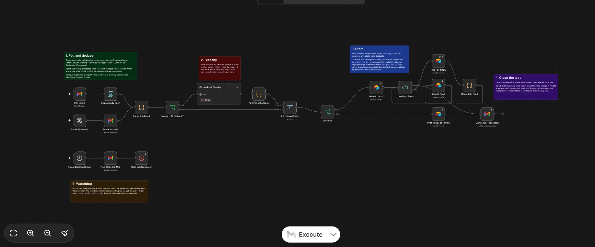
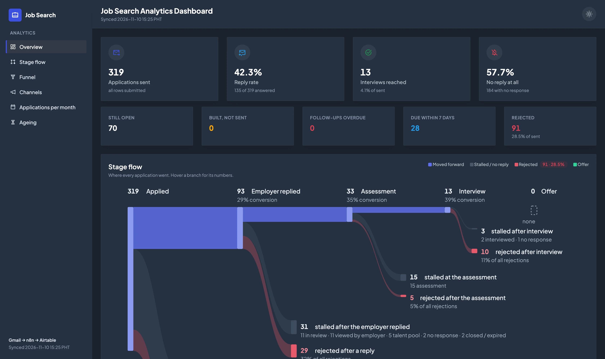
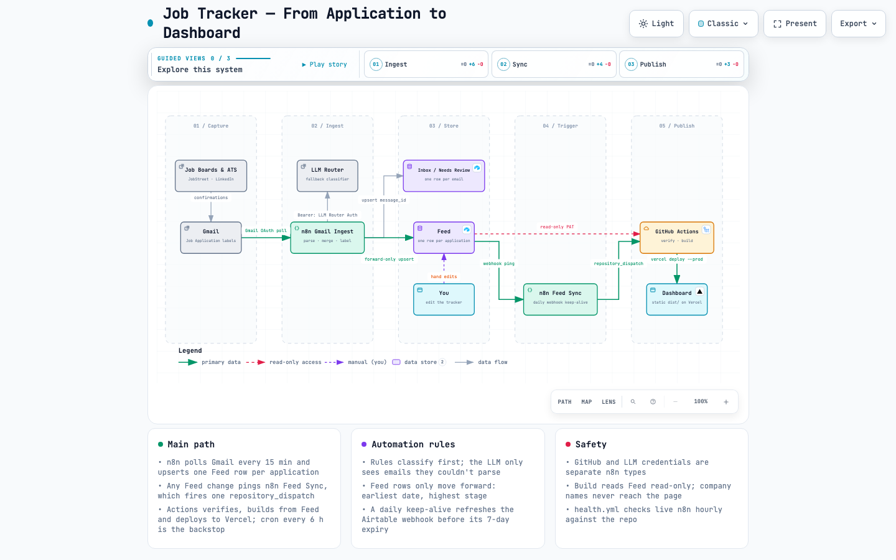

# Job Tracker

Turns job-application emails into an analytics dashboard. Gmail receives a confirmation or
status update, n8n classifies it and writes it to Airtable, and GitHub Actions rebuilds a static
page on Vercel within minutes.



## Dashboard preview



## Overview

| Stage | Tool | What happens |
|---|---|---|
| Capture | Gmail | Application mail is labelled `Job Application` or matches a confirmation phrase |
| Classify | n8n | Pattern rules read each email; an LLM is tried only when the rules fail |
| Store | Airtable | One row per application in `Feed`; one row per email in `Inbox` or `Needs Review` |
| Build | GitHub Actions | Reads nine non-identifying fields, aggregates them, renders the page |
| Publish | Vercel | Serves the static dashboard |
| Monitor | GitHub Actions, Telegram | Hourly check of the live n8n instance; a message on every failed execution |

The project has no dependencies: Node 20+, no `npm install`.

## How it works

### Ingest

n8n polls Gmail every 15 minutes for mail under the `Job Application` label or matching phrases
such as "thank you for applying". Each email is classified by the pattern rules in
`n8n/parse-email.js`, logged, and upserted into `Feed` as one row per application, with the job
platform, the status and the furthest stage reached. Google Calendar interview invites are read
as an interview scheduled, with the job title taken from the event name. The job platform is
mapped to the `Source` value the dashboard reports.

### LLM fallback

When the rules cannot classify an email, it is sent once to an n8n Agent
("Job Email Classifier"). The Agent has no tools and no memory, because it reads untrusted email
text. Its result is constrained:

- Confidence is capped at medium.
- It never overrides a rules match.
- A malformed reply or an unrecognized status leaves the email unclassified.

The fallback can also fill in a missing company or job title. If neither the rules nor the LLM
name an employer and the mail is not from a job board, the application is filed under the
contact (the sender, or the recipient for mail you sent).

### Needs Review

An email goes to `Needs Review` instead of `Feed` when it is still unclassified, or when it has
no employer to key on (Indeed confirmations, for example). Without a company there is no key
that a later email about the same job could match.

### Merge rules

`n8n/merge-feed.js` only moves a row forward:

- It keeps the earliest date and the highest stage.
- A status never regresses. A late confirmation cannot set an interviewing application back to
  "Applied". Rejected outranks everything except Offer.
- Fields such as `Job Platform`, `Company` and `Source` are filled only when empty, so hand
  edits are kept.

Rows are matched on an `Application Key` (`company|job title`), ignoring case and spacing
around the `|`, so a key typed by hand and one generated by n8n refer to the same application.

### Rebuild and deploy

Any change to `Feed`, from n8n or from a hand edit in Airtable, fires an Airtable webhook. The
Feed sync workflow receives it and sends one `repository_dispatch` to GitHub Actions, which
verifies, builds and deploys to Vercel, then smoke-tests the deployed URL. A 6-hourly schedule
catches anything the webhook missed. Airtable webhooks expire 7 days after their last refresh,
so the Feed sync workflow also runs a daily keep-alive.

### Monitoring

- **Health check.** `.github/workflows/health.yml` runs `scripts/check-live.mjs` every hour. It
  fails when a live workflow differs from the generated JSON, is inactive or duplicated, shares
  the GitHub credential with another node, or has recent error executions. GitHub emails you
  when the run fails.
- **Stale mail alarm.** The ingest raises an error execution when job mail is still unprocessed
  after 2 hours, so a stuck Gmail trigger is distinguishable from a quiet inbox.
- **Error alerts.** Every failed execution in the ingest or Feed sync workflow sends a Telegram
  message naming the workflow, the failing node and the error. Repeats are de-duplicated.

### Dashboard

The page shows a stage-flow Sankey that splits each stage's losses into stalled (no reply) and
rejected, per-stage conversion rates, the status mix and monthly volume. If a tab is open when
a newer build ships, it shows a banner to reload.

## Workflow



The [interactive version](docs/system-overview.html) has guided views for the capture, automate
and publish stages, plus light/dark and pan/zoom.

n8n handles the Gmail side (OAuth, retries, dedupe). GitHub Actions handles building and
deploying the site. The only connection between them is the `repository_dispatch` call. n8n runs
three workflows, all generated from this repo by `scripts/build-n8n.mjs`:

| Workflow | Purpose |
|---|---|
| `job-tracker-ingest.json` | Gmail → `Inbox` / `Needs Review` / `Feed` |
| `job-tracker-feed-sync.json` | Airtable webhook → `repository_dispatch`, plus the daily keep-alive |
| `job-tracker-error-alert.json` | Error Trigger → Telegram; the error workflow of the other two |

## Privacy

The privacy boundary is the build, not the base. `Feed` stores `Company`, `Job Role` and
`Application Key` because n8n needs them to match emails to rows. `scripts/build.mjs` reads only
the nine fields listed under [Install](#1-create-the-airtable-base). `verify.mjs` fails if that
list grows to include an identifying field, and it searches the built `dist/` for company names
and email addresses. This is what allows the repo and the page to be public.

`Inbox` and `Needs Review` are the message-level log, one row per email. They are separate from
`Feed` so an automated write cannot overwrite a hand edit.

## Install

Full setup, including the Gmail label scheme and the n8n import, is in [DEPLOY.md](DEPLOY.md).

### 1. Create the Airtable base

Create a base with three tables: `Feed` (your tracker), `Inbox`, and `Needs Review`. The
dashboard reads these nine `Feed` fields, named exactly:

| Field | Type |
|---|---|
| `Date Applied` | Date |
| `Source` | Single line text |
| `Work Setup` | Single line text |
| `Status` | Single select or single line text |
| `Resume` | Checkbox |
| `Cover Letter` | Checkbox |
| `Tailored` | Checkbox |
| `Next Follow Up` | Date |
| `Max Stage` | Number |

n8n also needs `Job Platform`, `Company` and `Application Key` on `Feed`, plus the fields of the
two log tables. [DEPLOY.md §3.1](DEPLOY.md) has all of them.

### 2. Create a personal access token

Airtable → your account → **Developer hub → Personal access tokens → Create token**. Scope it to
`data.records:read` on this base only. Airtable shows the token (`pat...`) once, so copy it now.

### 3. Add the GitHub secrets

**Settings → Secrets and variables → Actions → New repository secret:**

| Secret | Value |
|---|---|
| `AIRTABLE_API_KEY` | the token from step 2 |
| `AIRTABLE_BASE_ID` | from the base's API docs (**Help → API documentation**); looks like `appXXXXXXXXXXXXXX` |

`AIRTABLE_TABLE_NAME` is optional; it defaults to `Feed`. Deploying also needs `VERCEL_TOKEN`,
`VERCEL_ORG_ID` and `VERCEL_PROJECT_ID`. The health check needs `N8N_API_URL` and
`N8N_API_KEY`. Add those two before `health.yml` is on `main`, or it fails every hour until you
do. All seven are in [DEPLOY.md §2.5](DEPLOY.md).

### 4. Set up Vercel

[DEPLOY.md §2](DEPLOY.md) covers creating the project, turning off Deployment Protection, and
the access token. Then run **Actions → Build and deploy → Run workflow**. It ends by
smoke-testing the URL of the deployment it just made, and fails if the page is not up.

### 5. Wire up n8n

[DEPLOY.md §3](DEPLOY.md) covers each step:

| Section | Step |
|---|---|
| §3.2–3.4 | Gmail labels, importing `n8n/job-tracker-ingest.json`, credentials, and the one-off backfill over older mail |
| §3.3 | Publishing the "Job Email Classifier" Agent the LLM fallback calls. The workflow node itself holds no credential |
| §3.6 | `n8n/job-tracker-feed-sync.json`, which rebuilds the dashboard after any Feed change |
| §3.8 | The hourly health check |
| §3.9 | `n8n/job-tracker-error-alert.json` and the Telegram chat it messages |

## Usage

```bash
# build against the checked-in fixture: no network, no secret
FEED_FIXTURE=./sample-feed.json node scripts/build.mjs
open dist/index.html

# build against the real base
AIRTABLE_API_KEY=pat... AIRTABLE_BASE_ID=app... node scripts/build.mjs

# the pre-deploy gate; run this before every commit
node scripts/verify.mjs

# the pieces it tests, one at a time
node scripts/test-parser.mjs            # email classifier
node scripts/test-merge-feed.mjs        # forward-only Feed merge
node scripts/test-llm-fallback.mjs      # LLM fallback
node scripts/test-airtable-webhook.mjs  # Feed webhook keep-alive
node scripts/test-check-live.mjs        # live drift detector
node scripts/test-error-alert.mjs       # Telegram error alert

# after editing anything in n8n/, regenerate all three workflows, then re-import them
node scripts/build-n8n.mjs

# compare the live n8n instance against the generated workflows
N8N_API_URL=https://n8n.example.com N8N_API_KEY=... node scripts/check-live.mjs
```

`sample-feed.json` is a de-identified snapshot (dates, sources and statuses only), shaped like
Airtable's list-records API response, so the build is testable without touching the real base.

## Layout

| Path | What |
|---|---|
| `scripts/build.mjs` | Airtable → aggregate → Sankey layout → fill the template |
| `scripts/verify.mjs` | pre-deploy gate: funnel arithmetic, the privacy boundary, n8n invariants |
| `scripts/build-n8n.mjs` | generates the three n8n workflows from the code in `n8n/*.js` |
| `scripts/check-live.mjs` | compares the running n8n instance to the generated workflows |
| `scripts/test-*.mjs` | run the classifier, Feed merge, LLM fallback, webhook keep-alive, live check and error alert outside n8n |
| `n8n/parse-email.js` | the email classifier (edit this, never the generated JSON) |
| `n8n/llm-fallback.js` | LLM classification for emails the rules couldn't parse |
| `n8n/merge-feed.js` | merges a parsed email into its `Feed` row, forward only |
| `n8n/airtable-webhook.js` | the Feed webhook keep-alive's decision: create, refresh or re-enable |
| `n8n/error-alert.js` | formats and de-duplicates failure alerts |
| `n8n/gmail-labels.json` | Gmail label IDs the workflow applies |
| `n8n/job-tracker-ingest.json`, `n8n/job-tracker-feed-sync.json`, `n8n/job-tracker-error-alert.json` | generated workflows to import; never hand-edit |
| `templates/dashboard.html` | TailAdmin markup, Tailwind config, chart code |
| `icons8.json` | locks the Icons8 pack and icon ids the dashboard uses |
| `data/summary.json` | aggregate counts, committed every run; git history is the time series. Not written by fixture builds. Also shipped in `dist/` for the new-data banner |
| `sample-feed.json` | de-identified fixture for local dev and CI |
| `docs/system-overview.*` | the architecture diagram, source and rendered |
| `.github/workflows/deploy.yml` | verify, build, commit the summary, deploy, smoke-test |
| `.github/workflows/health.yml` | hourly `check-live.mjs` run; a failure emails you |

## Troubleshooting

**"AIRTABLE_API_KEY / AIRTABLE_BASE_ID are not set"**: set both secrets, or build against the
fixture with `FEED_FIXTURE=./sample-feed.json`.

**"Airtable fetch failed: 401/403"**: the token lacks `data.records:read` on this base, or is
scoped to the wrong one.

**"Feed table returned zero records"**: wrong base or table ID, or `Feed` really is empty.

**Month chart is empty, everything else works.** `Date Applied` isn't a real Date field in
Airtable, so it doesn't match `YYYY-MM-DD`.

**Charts are blank but the tiles show numbers.** ApexCharts didn't load from cdnjs. The Sankey
survives because it's server-rendered SVG.

**Scheduled runs stopped after a couple of months.** GitHub disables cron after 60 days of repo
inactivity. The `data/summary.json` commit exists to prevent exactly this.

**The schedule runs late.** Expected: Actions cron is best-effort. Treat it as "a few times a
day," never "on the hour." Feed changes don't wait for it: the webhook rebuilds within seconds.

**Edits in Airtable only show up on the 6-hourly run.** The Feed webhook lapsed. Webhooks
expire 7 days after they're created or last refreshed, and Airtable turns off notifications
after about a day of failed pings. Check the Feed sync workflow's **Daily Keep-Alive**
executions, and that n8n's Airtable token has `webhook:manage`
([DEPLOY.md §3.6](DEPLOY.md)).

**The "n8n health" workflow is failing.** Read its log. It names the problem: a workflow that
differs from the repo, is inactive or duplicated, or had error executions. That includes the
ingest's **Stale Job Mail Alarm**, which fires when job mail is still unprocessed after 2h. For
drift, regenerate and re-import ([DEPLOY.md §3.7](DEPLOY.md)); don't patch it in the n8n UI.

**No Telegram message arrived for a failed execution.** Check that the Error alert workflow is
active and that the ingest and Feed sync workflows name it as their error workflow
([DEPLOY.md §3.9](DEPLOY.md)).

**The same application has two `Feed` rows.** Their `Application Key`s differ by more than case
and spacing around `|`, for example `Acme Corporation` vs `Acme`. Fix one key by hand to match
the other, then delete the extra row.

## TODO

- Row-per-application matching in `Inbox`, blocked on fuzzy company/title matching, which is a
guess a log shouldn't be making
- Commit row-level history instead of daily aggregates, once the privacy tradeoff is settled
- Time-in-stage analytics, once there's a month or so of committed history to compute it from

## Status

Active, single maintainer, running against one person's real job search. No external
contributions expected.
